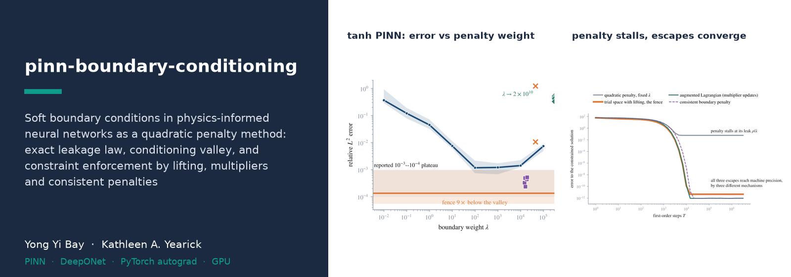
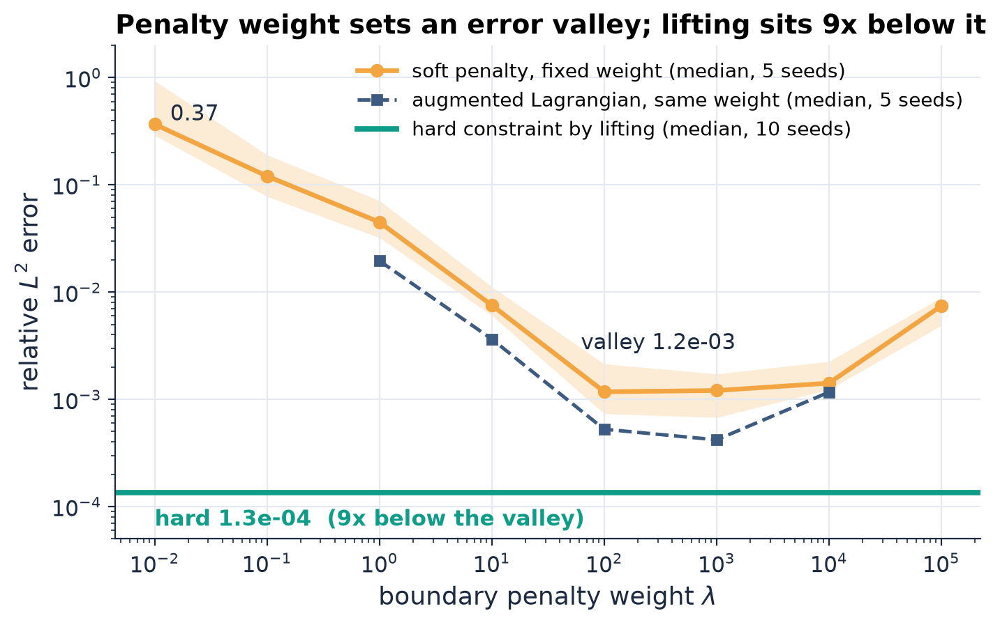
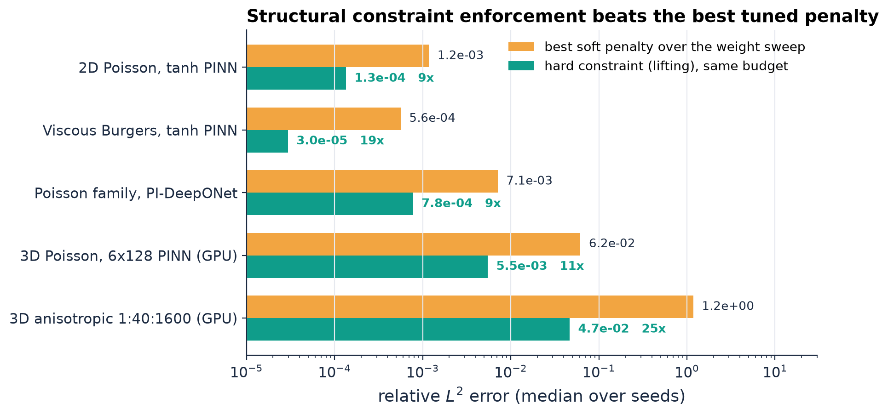
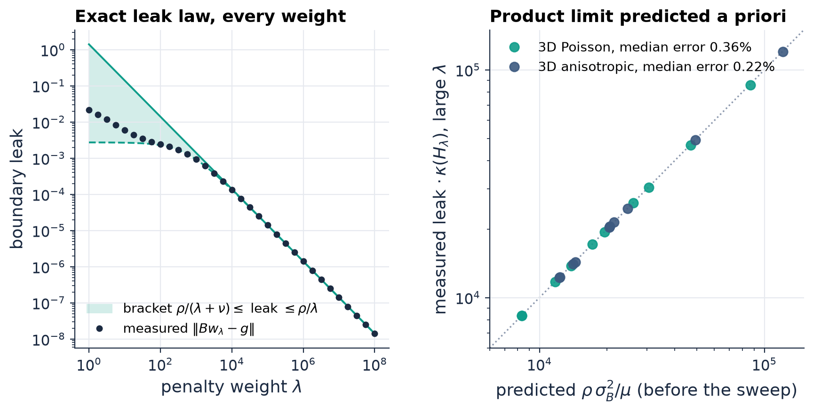

<p align="center">
  
</p>

# pinn-boundary-conditioning

[](https://github.com/bay-yearick-lab/pinn-boundary-conditioning/actions/workflows/tests.yml)
[](LICENSE)
[](pyproject.toml)
[](https://pytorch.org)

Yong Yi Bay and Kathleen A. Yearick

## Overview

The boundary weight in a physics-informed neural network (PINN) is a classical quadratic penalty parameter, and its cost can be computed before training. In the fixed-feature or tangent-kernel regime the boundary violation of the trained minimizer is exactly (N + λI)<sup>-1</sup>y\*, where y\* is the Lagrange multiplier of the hard-constrained least-squares problem and N is a boundary Schur complement. That one identity gives a two-sided leak bound at every weight, a U-shaped conditioning valley, and a leak-conditioning product with the a-priori limit ρσ<sub>B</sub><sup>2</sup>/μ. On 3D Poisson and a 3D anisotropic 1:40:1600 operator the predicted product matches the measured one to a median 0.36% and 0.22% over ten seeds.

The same constants pick the fix. On a 2D Poisson tanh PINN trained with Adam, sweeping the weight moves the relative L<sup>2</sup> error from 0.37 to a valley of 1.2 x 10<sup>-3</sup>; the hard-constrained twin with the boundary data built into the trial space reaches 1.3 x 10<sup>-4</sup>, 9x below the best weight, with no weight to tune. A physics-informed DeepONet shows the same valley at the operator level (7.1 x 10<sup>-3</sup>), and installing the boundary lifting family-wide takes it to 7.8 x 10<sup>-4</sup> over ten seeds. On GPU-trained 6x128 networks in 3D the hard twin wins by 11x (Poisson) and 25x (anisotropic).

The code is NumPy/SciPy for the exact linear algebra and PyTorch for the neural solvers: PDE residuals by autograd (differentiable programming), per-sample Jacobians for tangent-kernel constants, Adam and L-BFGS training on CUDA when available. `make verify` checks every exact law (101 checks) and recomputes the headline numbers in under six minutes on a 4-thread CPU.

## Results

| Test | Measured result |
| --- | --- |
| Exact leak law, fixed features (1D, 2D) | ρ/(λ+ν) ≤ ‖Bw<sub>λ</sub> − g‖ ≤ ρ/λ at all 41 weights from 10<sup>-2</sup> to 10<sup>8</sup>; Pareto slope dP/dQ = −λ and envelope law J′(λ) = Q/2 to 10<sup>-4</sup> relative |
| Leak-conditioning product, 3D Poisson (10 seeds) | a-priori ρσ<sub>B</sub><sup>2</sup>/μ vs measured: median error 0.36%, max 0.92%; leak brackets hold at every weight |
| Same, 3D anisotropic 1:40:1600, κ<sub>red</sub> ≈ 2 x 10<sup>6</sup> (10 seeds) | median error 0.22%, max 0.90% |
| 2D Poisson, 4x64 tanh PINN, Adam, 20k steps | soft penalty 0.37 (λ = 10<sup>-2</sup>) to 1.2 x 10<sup>-3</sup> (λ = 10<sup>2</sup>) to 7.4 x 10<sup>-3</sup> (λ = 10<sup>5</sup>); augmented Lagrangian 4.2 x 10<sup>-4</sup>; hard constraint 1.3 x 10<sup>-4</sup> (10 seeds), boundary exact to 2 x 10<sup>-8</sup> |
| Forced viscous Burgers, tanh PINN | best penalty 5.6 x 10<sup>-4</sup>; lifted twin 3.0 x 10<sup>-5</sup> (19x), constraint residual below 2.7 x 10<sup>-9</sup> |
| Physics-informed DeepONet, Poisson family with random forcing and boundary data | best penalty 7.1 x 10<sup>-3</sup>; family-wide lifting 7.8 x 10<sup>-4</sup> (9x), range 6.1 to 9.2 x 10<sup>-4</sup> over 10 seeds |
| 3D Poisson, 6x128 tanh PINN on GPU, 8000 + 2000 collocation points | predicted valley [1.8 x 10<sup>2</sup>, 10<sup>4</sup>] contains the observed best weight 10<sup>3</sup>; best penalty 6.2 x 10<sup>-2</sup>, hard twin 5.5 x 10<sup>-3</sup> (11x), 8 seeds each |
| 3D anisotropic 1:40:1600, same network on GPU | best penalty 1.2; hard twin 4.7 x 10<sup>-2</sup> (25x) |
| Convergence ladder, first-order iterations (fixed features) | fixed penalty stalls at 5.8 x 10<sup>-2</sup>; augmented Lagrangian 9.4 x 10<sup>-13</sup>, consistent boundary penalty 8.9 x 10<sup>-13</sup>, lifted trial space 4.5 x 10<sup>-12</sup> |
| Budget frontier, gradient descent at T = 10<sup>4</sup> | best soft weight 1.2 x 10<sup>-2</sup>; hard constraint 1.2 x 10<sup>-10</sup>; soft envelope decays like 1/T, heavy-ball like 1/T<sup>2</sup>, hard geometrically |
| Floating-point floor of exact penalized solves | float32 bottoms at 6.8 x 10<sup>-4</sup>, float64 at 2.0 x 10<sup>-8</sup>: the κ(λ)ε<sub>mach</sub> branch caps soft constraints near √(ρ ε<sub>mach</sub>) |

<p align="center"></p>

**Figure 1.** 2D Poisson, 4x64 tanh PINN, Adam, 20,000 steps. Relative L<sup>2</sup> error against the boundary penalty weight λ: soft penalty (median and range over 5 seeds), augmented Lagrangian at the same weight (multiplier updated every 500 steps), and the hard-constrained twin u = G + x(1−x)y(1−y)N(x, y) with a transfinite-interpolation lifting G (median of 10 seeds). The penalty branch is a conditioning valley: too small a weight leaks, too large a weight stiffens the loss. Lifting removes both terms.

<p align="center"></p>

**Figure 2.** Best penalty over the full weight sweep against the hard constraint at the same optimizer budget, five testbeds: 2D Poisson and viscous Burgers tanh PINNs, a physics-informed DeepONet for a Poisson family, and GPU-trained 6x128 tanh PINNs on 3D Poisson and a 3D anisotropic operator (error against a 49<sup>3</sup> finite-difference reference). Medians over 5 to 10 seeds.

<p align="center"></p>

**Figure 3.** Left: boundary leak of the penalized least-squares minimizer on the 2D tensor-Fourier testbed against the exact two-sided bracket ρ/(λ+ν) ≤ leak ≤ ρ/λ. Right: leak-conditioning product predicted from ρ, σ<sub>B</sub>, μ before any sweep, against the value measured by float64 direct solves at large λ, ten seeds on each 3D testbed (216 features, 1600 interior and 72 boundary points).

## Method

**Soft boundary conditions are a penalty method.** A PINN loss ½‖r(w)‖<sup>2</sup> + (λ/2)‖b(w)‖<sup>2</sup> linearizes, for random features, extreme-learning machines, or a wide network in the tangent-kernel regime, to the collocated least-squares problem Aw ≈ f, Bw ≈ g. The hard-constrained problem min ‖Aw − f‖ subject to Bw = g has KKT multiplier y\*, and ρ = ‖y\*‖ is the shadow price of the boundary condition: zero when the model class has a free lifting, positive whenever interior fit and boundary data compete.

**Exact leak law.** The penalized minimizer satisfies the perturbed KKT system A<sup>T</sup>(Aw<sub>λ</sub> − f) + B<sup>T</sup>y<sub>λ</sub> = 0 with y<sub>λ</sub> = λ(Bw<sub>λ</sub> − g), so the boundary residual is the resolvent (N + λI)<sup>-1</sup>y\* of the boundary Schur complement N. This gives ρ/(λ+ν) ≤ leak ≤ ρ/λ with ν = ‖N‖<sub>2</sub>, a multiplier estimate λ·leak that rises monotonically to ρ, the Pareto slope dP/dQ = −λ (the weight is the price on the supported tradeoff curve), and the envelope law J′(λ) = leak<sup>2</sup>/2. The multiplier, Pareto and envelope identities also hold at any regular stationary point of a smooth nonlinear model, checked on a tanh network driven to tight stationarity with L-BFGS.

**Conditioning valley.** κ(A<sup>T</sup>A + λB<sup>T</sup>B) grows like λσ<sub>B</sub><sup>2</sup>/μ on the stiff branch and like 1/λ on the starved branch. No scalar, diagonal (pointwise) or full positive-definite boundary weight brings it below κ<sub>red</sub>, the condition number of the hard-constrained reduced problem (the fence bound). Adaptive weighting rules move along the valley; the leak-conditioning product tends to ρσ<sub>B</sub><sup>2</sup>/μ and is at least half that for every λ ≥ ν. Gradient descent then pays an algebraic 1/T envelope, every constant-parameter momentum method at best 1/T<sup>2</sup> (slow-mode companion radius ≥ 1 − √(ηh<sub>s</sub>) for all stable pairs), and exact solves pay κ(λ)ε<sub>mach</sub>.

**Constraint-enforcement escapes.** Three mechanisms remove the leak instead of trading it against conditioning: augmented Lagrangian (method of multipliers) updates that learn y\* at a fixed moderate weight; a consistent boundary penalty that adds the multiplier term y\*<sup>T</sup>(Bw − g) so the stationary point is exact for every weight, as in consistent finite-element boundary penalties; and a lifted trial space u = G + φN with G matching the boundary data and φ vanishing on the boundary, the neural analogue of essential boundary conditions. All three converge geometrically to machine precision on the fixed-feature ladder. The a-priori diagnostic (compute ρ, ν, μ, σ<sub>B</sub>, κ<sub>red</sub> at a short warmup, then commit to an arm) chose the arm the sweep would have chosen on the 2D Poisson, indefinite Helmholtz and advection-dominated problems, before the sweep ran.

**Neural solvers.** Trained experiments use tanh MLPs with second derivatives by PyTorch autograd, Adam with cosine schedules, and L-BFGS with strong-Wolfe line search. Tangent-kernel constants of trained networks come from per-sample parameter Jacobians assembled into kernel-side Gram matrices. The operator-learning arm is a physics-informed DeepONet trained data-free on a family of Poisson problems with random forcing and boundary data. The 3D study trains 6x128 networks on a CUDA GPU and scores them against a sparse-LU finite-difference reference.

### Where things live

| Component | File |
| --- | --- |
| Feature models, collocated A, B, f, g; nullspace KKT solve for w\*, y\*; penalized solve | [`src/problems.py`](src/problems.py) |
| Boundary Schur complement N, leak bracket, Pareto slope, envelope law, product bound, momentum-family radius, matrix-weight fence, noise-calibrated weight | [`src/verify_exact_laws.py`](src/verify_exact_laws.py) |
| Resolvent identity and leak asymptotics | [`src/verify_statics.py`](src/verify_statics.py) |
| Exact spectral propagation of gradient descent and heavy-ball | [`src/verify_dynamics.py`](src/verify_dynamics.py) |
| Conditioning valley and iterations-to-tolerance | [`src/verify_ushape.py`](src/verify_ushape.py) |
| Coupled weight schedules, minibatch leak variance by discrete Lyapunov equation | [`src/verify_extensions.py`](src/verify_extensions.py), [`src/verify_coupled_path.py`](src/verify_coupled_path.py) |
| A-priori diagnostic constants and confirming sweep (3D) | [`src/exp_diagnostic_3d.py`](src/exp_diagnostic_3d.py), [`src/exp_diagnostic_holdout.py`](src/exp_diagnostic_holdout.py) |
| Augmented Lagrangian, consistent penalty, lifted trial space ladder | [`src/exp_ladder.py`](src/exp_ladder.py) |
| float32 / float64 floor of penalized solves | [`src/exp_precision_floor.py`](src/exp_precision_floor.py) |
| tanh PINN, autograd Laplacian, transfinite lifting, multiplier arm | [`src/exp_pinn_sweep.py`](src/exp_pinn_sweep.py) |
| Gradient-statistic and kernel-trace weighting rules | [`src/exp_pinn_adaptive.py`](src/exp_pinn_adaptive.py) |
| Tangent-kernel constants from per-sample Jacobians | [`src/exp_ntk_constants.py`](src/exp_ntk_constants.py), [`src/exp_prospective_trained.py`](src/exp_prospective_trained.py) |
| Physics-informed DeepONet with family-wide lifting | [`src/exp_operator.py`](src/exp_operator.py) |
| GPU 3D sweep, 3D transfinite lifting, sparse finite-difference reference | [`src/exp_trained_3d.py`](src/exp_trained_3d.py) |
| Nonlinear stationary-point identities (Adam then L-BFGS) | [`src/verify_nonlinear.py`](src/verify_nonlinear.py) |

## Layout

```
src/          problem builders, verification suite, experiments (NumPy/SciPy, PyTorch)
tests/        pytest numerical validation: exact laws and the reported numbers
benchmarks/   diagnostic vs sweep cost, recorded training wall times
scripts/      verify.sh, headline numbers, paper figures
tools/        README hero and result cards
data/         run records (json / jsonl, all under 0.6 MB)
assets/       README images
```

## Reproducing

```bash
uv sync --extra test            # or: pip install numpy scipy matplotlib pytest
make verify                     # under 6 min on a 4-thread CPU (or: sh scripts/verify.sh)
make test                       # pytest numerical validation, under 1 min
```

`make verify` runs six `verify_*` scripts (each prints `[PASS]` per check and exits nonzero on any failure) and the held-out and 3D a-priori diagnostics (predicted against measured constants), then recomputes the headline numbers from `data/`. The last lines read:

```
[PASS] ... (101 checks across six verify_* scripts, each ending in ALL PASS)
...
testbed                       rho   kappa_red   prod pred   prod meas prod relerr  rho relerr  valley lam
3D Poisson              2.088e+02   1.038e+06   1.834e+04   1.829e+04      0.36%       0.44%    5.48e+03
3D stiff anisotropic    6.994e+07   1.994e+06   2.050e+04   2.044e+04      0.22%       0.35%    3.80e+09

HEADLINE RESULTS (median relative L2 error over seeds)
------------------------------------------------------------------------------
2D Poisson tanh PINN   soft lam=1e-2 0.37 -> valley 1.2e-03 (lam=100); hard twin 1.3e-04 (8.7x)
                       augmented Lagrangian best 4.2e-04 (2.8x below the best fixed penalty)
Viscous Burgers PINN   valley 5.6e-04 (lam=10); hard twin 3.0e-05 (19.1x)
PI-DeepONet (10 seeds) valley 7.1e-03 (lam=10); lifted 7.8e-04 (9.2x)
3D Poisson, GPU        best soft 6.2e-02; hard twin 5.5e-03 (11x)
3D anisotropic, GPU    best soft 1.2e+00; hard twin 4.7e-02 (25x)
3D Poisson             product limit rho*sB^2/mu predicted a priori: median error 0.36% (max 0.92%, 10 seeds)
3D stiff anisotropic   product limit rho*sB^2/mu predicted a priori: median error 0.22% (max 0.90%, 10 seeds)
------------------------------------------------------------------------------
```

Further targets:

```bash
make verify-slow        # adds the nonlinear stationary-point check (needs torch)
make experiments        # fixed-feature data and 2D neural sweeps (torch; CUDA if available)
make experiments-neural # tangent-kernel constants, prospective test, minibatch, schedules
make experiments-gpu    # 3D 6x128 sweep on a CUDA GPU, about 30 min
make assets             # README images from data/ and paper figures
make benchmarks         # benchmarks/results.md
```

Benchmarks are in [`benchmarks/results.md`](benchmarks/results.md): on the 3D testbeds the a-priori diagnostic constants cost 20 ms against 0.34 s for the 85-weight direct-solve sweep they replace, and one GPU training run of the 6x128 3D network takes 11 s (soft penalty) to 44 s (hard twin).

## Citation

```bibtex
@article{bay2026softbc,
  title  = {Soft Boundary Conditions in Physics-Informed Neural Networks:
            A Penalty-Method Analysis of Leakage, Conditioning, and Structural Escapes},
  author = {Bay, Yong Yi and Yearick, Kathleen A.},
  year   = {2026},
  note   = {In preparation}
}
```

## License

MIT ([LICENSE](LICENSE)).
